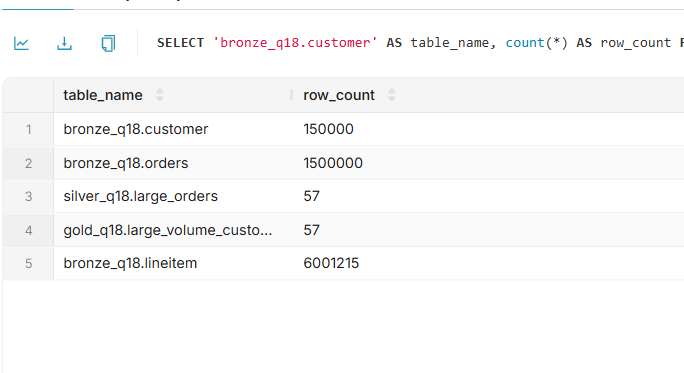

# Отчёт по практической работе №1

**Тема:** локальный Lakehouse, ELT-преобразование и бенчмарк форматов и сжатия.

## 1. Вариант и масштаб

| Поле | Значение |
|---|---|
| ФИО как в VK Education | Кадыров Артур Рустамович |
| Вариант | 3 — Q18 «Large Volume Customer» |
| Масштаб | sf1 |
| Обоснование масштаба | Около 6 млн позиций заказов достаточно для локального эксперимента с группировкой, соединениями и форматами хранения. Объём помещается на учебном компьютере и позволяет выполнить несколько повторений запросов. На всех слоях использован один масштаб. |

Данные получены через встроенный коннектор Trino `tpch`, из схемы `tpch.sf1`. Внешние файлы исходных данных не скачивались.

Использован уже работающий локальный стенд. Повторное развёртывание одинаковых сервисов не выполнялось. Для Q18 созданы отдельные схемы и собственные SQL-сценарии, таблицы, проверки и измерения.

## 2. Сервисы и обоснование выбора

| Сервис | Роль | Обоснование |
|---|---|---|
| Silo | S3-совместимое объектное хранилище | Хранит файлы таблиц и метаданные Iceberg. Позволяет использовать S3 API локально. Применён вместо первоначально рассматривавшегося MinIO. |
| PostgreSQL 16 | База состояния Lakekeeper | Подходит для постоянного хранения транзакционных служебных записей каталога. |
| Lakekeeper 0.14.0 | Iceberg REST Catalog | Предоставляет каталог таблиц через REST API и связывает таблицы с их метаданными. |
| Trino 483 | SQL-движок | Поддерживает TPC-H, Iceberg и S3. Выполняет загрузку, преобразования и аналитические запросы. |
| Apache Superset 6.1.0 | BI-инструмент в Docker | Через драйвер Trino предоставляет SQL Lab и средства визуализации без выгрузки данных из Lakehouse. |
| DBeaver | SQL-клиент Windows | Использован для выполнения SQL, проверки результатов и просмотра Execution из EXPLAIN ANALYZE. |

Использованные образы:

- `pgsty/silo:RELEASE.2026-09-03T13-18-01Z`;
- `postgres:16`;
- `quay.io/lakekeeper/catalog:latest-main`;
- `trinodb/trino:483`;
- `local/superset-trino:6.1.0`, собран из `apache/superset:6.1.0`.

Основные образы закреплены digest из использованного окружения в Compose; соответствия приведены в images.lock.json. Базовый образ Superset указан тегом 6.1.0.

### Архитектура

DBeaver и Superset отправляют запросы в Trino. Для таблиц Iceberg движок получает сведения каталога из Lakekeeper и читает либо записывает файлы в Silo. PostgreSQL хранит состояние каталога Lakekeeper; сами файлы аналитических таблиц находятся в объектном хранилище.

Warehouse: `lakehouse`. Бакет: `lakehouse`. Префикс: `warehouse`.

Адреса внутри Docker:

- S3: `http://silo:9000`;
- Iceberg REST Catalog: `http://lakekeeper:8181/catalog`;
- Trino: `http://trino:8080`.

### Конфигурации и команды

Основной стек описан в `compose.yaml` и `compose.override.yaml`. Конфигурация SQL-движка находится в `trino/`.

Команды основного стека:

```powershell
docker compose up -d
docker compose ps -a
```

Первоначальная подготовка хранилища включает создание бакета и регистрацию warehouse в Lakekeeper. Использованы регион `us-east-1` и S3 path-style access.

Контейнер `lakekeeper-migrate` выполняет миграции и завершается с кодом 0. Это нормальное завершение, а не авария.

Для Trino настроены каталоги `tpch` и `iceberg`. Основной формат — Parquet, кодек — ZSTD. Доступ к S3 в выполненном локальном окружении настроен через статические credentials; выдача credentials каталогом отключена.

Superset описан отдельно в `compose.bi.yaml`. В образ установлен драйвер `trino[sqlalchemy]==0.336.0`.

```powershell
docker compose -f compose.bi.yaml build superset
docker compose -f compose.bi.yaml run --rm superset superset db upgrade
docker compose -f compose.bi.yaml run --rm superset superset fab create-admin
docker compose -f compose.bi.yaml run --rm superset superset init
docker compose -f compose.bi.yaml up -d superset
docker compose -f compose.bi.yaml ps -a
```

Команды первоначальной настройки приведены для воспроизведения. В ходе Q18 использовались уже настроенные сервисы и подключение Superset.

Перед публикацией секреты вынесены в локальные переменные окружения; .env и .env.bi исключены из Git. Имена Compose-проектов и сети согласованы для отдельного проекта Q18. Основные образы закреплены digest в Compose и images.lock.json. Свежий отдельный запуск не выполнялся; конфигурации проверены через docker compose config, SQL-проверки выполнены на работающем стенде.

## 3. Разбор Q18

Запрос выбирает заказы, у которых суммарное количество товара по всем позициям больше 300. Затем добавляет сведения о клиенте, вычисляет итоговое количество и выбирает до 100 заказов по убыванию totalprice, при равенстве — по orderdate.

Это рейтинг заказов с данными клиента, а не группировка всех заказов по клиенту. Один клиент потенциально может встречаться несколько раз.

| Таблица | Колонки | Использование |
|---|---|---|
| customer | custkey, name | Соединение с orders и вывод клиента |
| orders | orderkey, custkey, orderdate, totalprice | Соединения, вывод и сортировка |
| lineitem | orderkey, quantity | Суммирование количества и отбор заказов с суммой больше 300 |
| lineitem — дополнительная колонка | linenumber | Сохранение идентификатора позиции заказа в Bronze |

Исходный запрос:

```sql
SELECT
    c.name,
    c.custkey,
    o.orderkey,
    o.orderdate,
    o.totalprice,
    sum(l.quantity) AS total_quantity
FROM tpch.sf1.customer AS c
JOIN tpch.sf1.orders AS o ON c.custkey = o.custkey
JOIN tpch.sf1.lineitem AS l ON o.orderkey = l.orderkey
WHERE o.orderkey IN (
    SELECT orderkey
    FROM tpch.sf1.lineitem
    GROUP BY orderkey
    HAVING sum(quantity) > 300
)
GROUP BY
    c.name, c.custkey, o.orderkey,
    o.orderdate, o.totalprice
ORDER BY o.totalprice DESC, o.orderdate
LIMIT 100;
```

## 4. Медальон

Слои размещены в отдельных схемах:

- `iceberg.bronze_q18`;
- `iceberg.silver_q18`;
- `iceberg.gold_q18`.

Размеры измерялись через `$files` Iceberg, по текущим файлам данных с `content = 0`. Использованы десятичные МБ: 1 МБ = 1 000 000 байт. Метаданные, старые снапшоты и неиспользуемые файлы в эти размеры не входят.

### Bronze

| Таблица | Колонки | Строк | Размер, МБ | Формат | Кодек | Партиционирование |
|---|---|---:|---:|---|---|---|
| customer | custkey, name | 150000 | 0,227 | PARQUET | ZSTD | Нет |
| orders | orderkey, custkey, orderdate, totalprice | 1500000 | 13,519 | PARQUET | ZSTD | Нет |
| lineitem | orderkey, linenumber, quantity | 6001215 | 8,431 | PARQUET | ZSTD | Нет |

Обоснование: сохранены исходные значения колонок, необходимых Q18, без бизнес-фильтров. Parquet поддерживает эффективное чтение выбранных колонок. ZSTD показал минимальный размер среди проверенных конфигураций.

Общий размер Bronze по сумме округлённых значений — приблизительно **22,177 МБ**.

### Silver

| Таблица | Колонки | Строк | Размер, МБ | Формат | Кодек | Партиционирование |
|---|---|---:|---:|---|---|---|
| large_orders | name, custkey, orderkey, orderdate, totalprice, total_quantity | 57 | 0,002 | PARQUET | ZSTD | Нет |

Преобразование:

1. Позиции Bronze группируются по orderkey.
2. Вычисляется `sum(quantity)`.
3. Сохраняются заказы с суммой больше 300.
4. Результат соединяется с orders и customer.
5. Формируется одна строка на крупный заказ.

Пример логики:

```sql
WITH order_quantities AS (
    SELECT orderkey, sum(quantity) AS total_quantity
    FROM iceberg.bronze_q18.lineitem
    GROUP BY orderkey
    HAVING sum(quantity) > 300
)
SELECT
    c.name, c.custkey, o.orderkey,
    o.orderdate, o.totalprice, q.total_quantity
FROM order_quantities AS q
JOIN iceberg.bronze_q18.orders AS o
    ON q.orderkey = o.orderkey
JOIN iceberg.bronze_q18.customer AS c
    ON o.custkey = c.custkey;
```

Повторное соединение с lineitem после агрегации не требуется: количество уже рассчитано по всем позициям заказа.

Нормализация структуры заключается в приведении данных к зерну «одна строка — один крупный заказ», а обогащение — в добавлении клиента, даты и суммы заказа. Отдельное исправление исходных имён клиентов не выполнялось. Для контроля предусмотрены проверки NULL, порога количества и уникальности orderkey.

Обоснование хранения: таблица мала, поэтому партиционирование не применялось. Сохранение Parquet + ZSTD упрощает конфигурацию слоёв.

### Gold

| Таблица | Колонки | Строк | Размер, МБ | Формат | Кодек | Партиционирование |
|---|---|---:|---:|---|---|---|
| large_volume_customer | name, custkey, orderkey, orderdate, totalprice, total_quantity | 57 | 0,002 | PARQUET | ZSTD | Нет |

Gold получен сортировкой Silver по `totalprice DESC, orderdate` и ограничением `LIMIT 100`.

На sf1 найдено 57 подходящих заказов, поэтому Gold содержит 57 строк. LIMIT 100 задаёт максимальное количество, а не требование получить ровно 100 строк.

Размеры Silver и Gold округлены до 0,001 МБ и не означают точное равенство количества байт.

Проверка соответствия исходному Q18 реализована в `sql/03_gold_checks.sql`: результаты сравниваются в обе стороны через `EXCEPT ALL` по всем шести колонкам. Проверка перед публикацией выполнена на работающем стенде: missing_in_gold = 0, unexpected_in_gold = 0. Результаты сохранены в results/validation.jsonl.

## 5. Тесты производительности

### Методология

Сравнивались Parquet + ZSTD, Parquet + GZIP и ORC + ZSTD.

Для каждого формата и кодека использовались одинаковые строки и колонки Bronze Q18, масштаб sf1 и отсутствие партиционирования. Экспериментальные копии создавались из собственного Bronze.

Аналитический тест — полный исходный Q18 над тремя таблицами соответствующей конфигурации. Чтение готового Gold не подменяло выполнение Q18.

Время фиксировалось из поля `Execution` результата `EXPLAIN ANALYZE`. Оно не включает отдельно показанные стадии Analysis, Planning, Queued и Finishing.

Для чтения выполнены один прогревочный запуск и пять измеряемых запусков. Итоговая метрика — медиана. Кэши между повторениями не очищались.

Запись каждой таблицы измерялась один раз через `EXPLAIN ANALYZE CREATE TABLE ... AS SELECT`. Она включает чтение исходной таблицы, обработку, запись и commit в рамках стадии Execution. Приведённая сумма — сумма трёх отдельных измерений, а не полное время запуска сценария.

### Время Q18

Все значения — секунды.

| Конфигурация | 1 | 2 | 3 | 4 | 5 | Медиана |
|---|---:|---:|---:|---:|---:|---:|
| Parquet + ZSTD | 1,300 | 1,290 | 1,130 | 1,150 | 1,000 | 1,150 |
| Parquet + GZIP | 1,050 | 1,520 | 1,240 | 1,070 | 1,310 | 1,240 |
| ORC + ZSTD | 1,020 | 0,907 | 0,929 | 0,976 | 1,040 | 0,976 |

### Время записи

| Таблица | Parquet + ZSTD, с | Parquet + GZIP, с | ORC + ZSTD, с |
|---|---:|---:|---:|
| customer | 0,501 | 2,441 | 0,772 |
| orders | 1,078 | 2,130 | 1,034 |
| lineitem | 1,619 | 2,370 | 1,920 |
| Сумма | 3,198 | 6,941 | 3,726 |

### Итоги

| Формат | Кодек | Размер Bronze, МБ | Запись, с | Медиана Q18, с |
|---|---|---:|---:|---:|
| Parquet | ZSTD | ≈22,177 | 3,198 | 1,150 |
| Parquet | GZIP | 23,825 | 6,941 | 1,240 |
| ORC | ZSTD | 26,930 | 3,726 | 0,976 |

Parquet + ZSTD показал минимальный размер и минимальную сумму времени записи. ORC + ZSTD выполнил Q18 быстрее по медиане, но потребовал больше места.

Для основных слоёв оставлен Parquet + ZSTD как компактный вариант с небольшим временем записи.

Ограничения: запись измерялась однократно, число повторений чтения невелико, времена зависят от кэшей и фоновой нагрузки. Физическое расположение строк и количество файлов принудительно не выравнивались. Это локальный учебный эксперимент, а не официальный результат TPC-H; выводы относятся к выбранным данным и условиям.

## 6. Осмысление и инструменты

### 6.1. Понять и объяснить

| Вопрос | Ответ |
|---|---|
| Зачем Lakehouse? | Позволяет хранить аналитические данные в объектном хранилище и отделять хранение от SQL-вычислений. Iceberg добавляет табличные метаданные, снапшоты и изменение схемы. Обычная БД остаётся подходящим выбором для многих задач; sf1 здесь используется для изучения архитектуры, а не для доказательства необходимости кластера. |
| Что показало изменение схемы? | В отдельной пятистрочной таблице Silver добавлена колонка analyst_note типа VARCHAR, затем переименована в processing_note. Существующие строки сохранились, новая колонка получила NULL. |
| Что показало восстановление? | После изменения заметок у пяти строк исходное состояние было прочитано через FOR VERSION AS OF и восстановлено через rollback_to_snapshot. |

Демонстрационная таблица: `iceberg.silver_q18.schema_demo`.

```sql
ALTER TABLE iceberg.silver_q18.schema_demo
ADD COLUMN analyst_note VARCHAR;

ALTER TABLE iceberg.silver_q18.schema_demo
RENAME COLUMN analyst_note TO processing_note;
```

Создание таблицы и полная последовательность находятся в `sql/09_schema_evolution.sql`.

### Time travel

Сохранённый ID снапшота: **2737917979539804092**.

```sql
UPDATE iceberg.silver_q18.schema_demo
SET processing_note = 'test_change';

SELECT *
FROM iceberg.silver_q18.schema_demo
FOR VERSION AS OF 2737917979539804092;

ALTER TABLE iceberg.silver_q18.schema_demo
EXECUTE rollback_to_snapshot(2737917979539804092);

SELECT
    count(*) AS row_count,
    count(processing_note) AS filled_notes
FROM iceberg.silver_q18.schema_demo;
```

После восстановления подтверждено:

| row_count | filled_notes |
|---:|---:|
| 5 | 0 |

При повторном создании таблицы ID снапшота будет другим. Перед экспериментом его следует получить через `schema_demo$snapshots`. Рабочие Silver и Gold демонстрацией не изменялись.

Полный сценарий: `sql/09_time_travel.sql`.

### 6.2. Дополнительный инструмент

| Инструмент | Обоснование |
|---|---|
| Apache Superset в Docker | Позволяет выполнять SQL и строить визуализации через Trino. Повторное развёртывание BI не требовалось: к существующему подключению доступны новые схемы Q18. |

Подключение через SQLAlchemy: `trino://student@trino:8080/iceberg/bronze`. В запросах явно указывались схемы Q18, поэтому исходная схема подключения не ограничивала доступ только к Q3.

Действия:

1. Открыт Superset по адресу `http://localhost:8088`.
2. Выполнен вход.
3. В SQL Lab выбрано подключение Trino.
4. Выполнен запрос количества строк собственных таблиц Q18.

```sql
SELECT 'bronze_q18.customer' AS table_name, count(*) AS row_count
FROM iceberg.bronze_q18.customer
UNION ALL
SELECT 'bronze_q18.orders', count(*)
FROM iceberg.bronze_q18.orders
UNION ALL
SELECT 'bronze_q18.lineitem', count(*)
FROM iceberg.bronze_q18.lineitem
UNION ALL
SELECT 'silver_q18.large_orders', count(*)
FROM iceberg.silver_q18.large_orders
UNION ALL
SELECT 'gold_q18.large_volume_customer', count(*)
FROM iceberg.gold_q18.large_volume_customer;
```

Результат: 150000, 1500000, 6001215, 57 и 57 строк соответственно. Проверка подтверждает доступ BI-инструмента к Bronze и другим слоям Q18. Отдельный дашборд не создавался.



## 7. Выводы

Реализован полный цикл Q18: загрузка выбранных колонок TPC-H, выделение крупных заказов на Silver и построение Gold. Найдено 57 заказов с суммарным количеством товара больше 300. В локальном опыте Parquet + ZSTD оказался самым компактным и быстрее записывался, а ORC + ZSTD показал минимальную медиану Q18. На отдельной таблице подтверждены изменение схемы и восстановление данных из снапшота. Superset продемонстрировал доступ к собственным таблицам Q18 через Trino.
